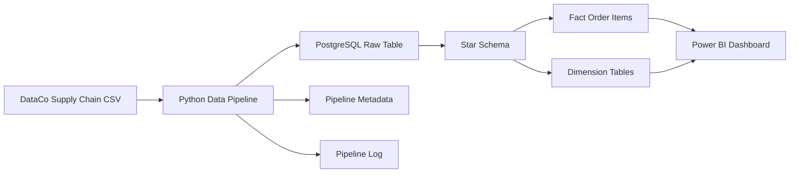
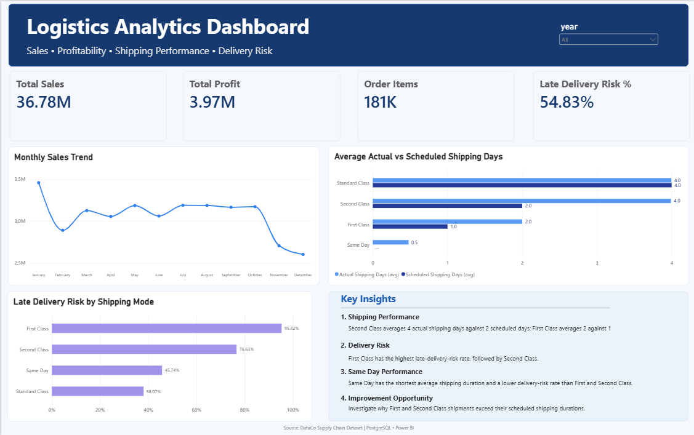

# Supply Chain Pipeline

An end-to-end data engineering project that processes supply-chain and logistics data using Python, PostgreSQL, and Power BI.

## Architecture



## What I Built

- Python pipeline for CSV ingestion and data validation
- Incremental loading using a watermark
- PostgreSQL raw and analytical layers
- Star schema with fact and dimension tables
- Pipeline logging and duplicate protection
- SQL data-quality and KPI validation
- Power BI dashboard for sales, profitability, shipping performance, and delivery risk
- Environment variables for secure database credentials

<!-- ## Data Model

**Fact:** `fact_order_items`

**Dimensions:** `dim_customer`, `dim_product`, `dim_date`, `dim_location` -->

## Dashboard



## Tech Stack

`Python` • `Pandas` • `PostgreSQL` • `SQL` • `Power BI` • `Git`

## Dataset

DataCo Smart Supply Chain dataset - 180,519 order-item records.

## Project Structure

```text
src/          Python pipeline
sql/          Warehouse schema and validation queries
screenshots/  Power BI dashboard
```
