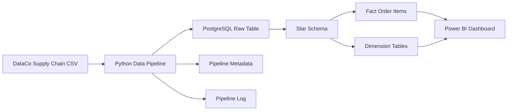

# Supply Chain Data Engineering & Analytics Pipeline

An end-to-end data engineering project that transforms raw supply-chain and logistics data into a PostgreSQL analytical warehouse and an interactive Power BI dashboard.

## Architecture



## Dashboard


## Project Overview

This project demonstrates an end-to-end data engineering workflow using a supply-chain dataset containing more than 180,000 order-item records.

The pipeline validates and loads raw CSV data into PostgreSQL, maintains incremental-load metadata and pipeline logs, transforms the data into a dimensional model, and exposes the analytical layer to Power BI for reporting.

## Tech Stack

- Python
- Pandas
- PostgreSQL
- SQL
- Power BI
- Git & GitHub

## Data Pipeline

The project follows this workflow:

1. Raw supply-chain data is read from CSV using Python and Pandas.
2. Source data is validated before loading.
3. New records are identified using a watermark-based incremental loading process.
4. Data is loaded into the PostgreSQL `logistics_raw` table.
5. Pipeline execution information is recorded for monitoring.
6. PostgreSQL transforms the raw data into a star schema.
7. Power BI connects to the analytical model for visualization and reporting.

## Data Model

The PostgreSQL warehouse uses a star-schema design.

### Fact Table

`fact_order_items`

Contains order-item level measures and operational attributes including:

- Sales
- Profit
- Quantity
- Discounts
- Actual shipping days
- Scheduled shipping days
- Late delivery risk

### Dimension Tables

- `dim_customer`
- `dim_product`
- `dim_date`
- `dim_location`

Foreign-key constraints maintain relationships between the fact and dimension tables.

## Data Engineering Features

- CSV ingestion with Python and Pandas
- PostgreSQL data warehouse
- Incremental loading using a watermark
- Duplicate protection
- Transaction-based database loading
- Pipeline execution logging
- Data-quality validation
- Primary and foreign-key constraints
- Star-schema dimensional modeling
- Environment-variable based database credentials

## Dashboard KPIs

The final Power BI dashboard reports:

| KPI | Result |
|---|---:|
| Total Sales | 36.78M |
| Total Profit | 3.97M |
| Order Items | 180,519 |
| Late Delivery Risk | 54.83% |

The dashboard also analyzes:

- Monthly sales trends
- Actual vs scheduled shipping duration
- Delivery risk by shipping mode
- Shipping performance

## Project Structure

```text
.
├── raw_datas/
├── screenshots/
│   └── dashboard.png
├── sql/
│   ├── schema.sql
│   └── validation_queries.sql
├── src/
│   ├── inspect_data.py
│   ├── load_to_postgres.py
│   └── test_incremental_pipeline.py
├── .env.example
├── .gitignore
├── requirements.txt
├── Logistics_Analytics_Dashboard.pbix
└── README.md
```

## Setup

Install the required Python packages:

```bash
pip install -r requirements.txt
```

Create a `.env` file using `.env.example` as the template:

```env
DB_HOST=localhost
DB_NAME=logistics_db
DB_USER=postgres
DB_PASSWORD=your_password_here
```

The `.env` file is excluded from Git to prevent database credentials from being committed.

## Run the Pipeline

```bash
python src/load_to_postgres.py
```

The pipeline validates the source data, checks the current watermark, identifies new records, loads them into PostgreSQL, and updates pipeline metadata.

## Data Validation

SQL validation queries are available in:

```text
sql/validation_queries.sql
```

These queries verify row counts, dimensional relationships, orphan records, and dashboard KPIs.

## Key Learnings

This project provided hands-on experience with:

- Designing an end-to-end data pipeline
- Loading data incrementally instead of performing full reloads
- Building dimensional models for analytics
- Maintaining data integrity with database constraints
- Separating credentials from source code
- Validating reporting metrics between PostgreSQL and Power BI
- Connecting data engineering workflows to business-facing analytics
